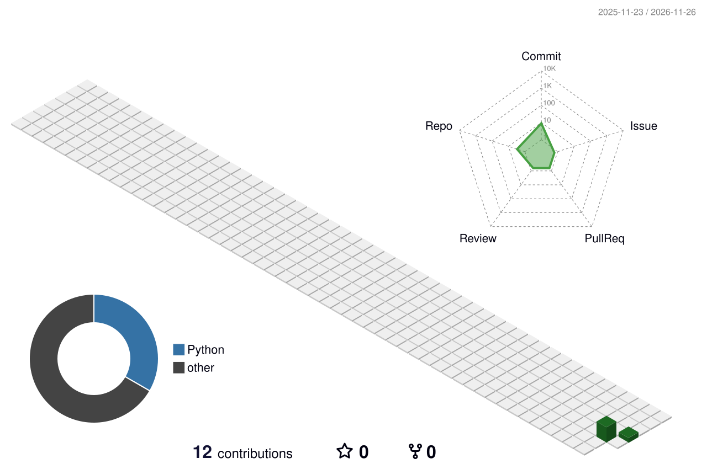

# 장하린 · HALYNNN

**로봇 · 자율주행 SW QA & 로봇 운영·관제 플랫폼**

데이터 품질 검증 실무와 ROS2 기반 다중 로봇 관제 시스템 경험을 바탕으로, 로봇이 실제 현장에서 의도대로 동작하는지를 검증하고 개선하는 일을 하고자 합니다.

---

## 💼 실무 경력

| 기간 | 소속 · 직무 | 주요 업무 |
|:---|:---|:---|
| **2026.01 ~ 재직 중** | **현대오토에버 공간지능시스템개발팀** · PMO Support 시너지랩 파견 | CLI 기반 Raw 이미지 수집 및 Superb AI 업로드 라벨링 가이드·영상인식 객체리스트 작성·편집 작업자 약 20명 질의 대응·산출물 검수·오류 기록 |
| **2025.03 ~ 2025.12** | **라포랩스** · CX 상품데이터 검수 | 상품 이미지·가격·카테고리·판매 조건 검수 |
| **2024.08 ~ 2024.09** | **핑크랩** · 로봇소프트웨어개발팀 인턴 | 오토콘 프로젝트 주행 경로 예측 모델 학습용 데이터 Roboflow 폴리곤 라벨링 |

---

## 🎯 핵심 역량

**① 데이터 품질·검증 파이프라인 실무** — `Superb AI` `CVAT` `Roboflow`

- 라벨링 가이드·객체리스트를 직접 작성·편집하고, 작업자 산출물을 검수하며 오류를 기록하는 검증 루프 운영
- 대량 이미지 데이터의 수집·업로드·검수 전 과정을 CLI와 라벨링 플랫폼으로 처리

**② ROS2 · 관제 시스템 · DB 통합 개발** — `ROS2 Humble` `WebSocket` `PyQt5` `MySQL`

- 다중 로봇(지게차형 AMR 3대) 관제를 위한 서버·GUI·DB 구조 설계와 구현
- 로봇 상태·작업 기록 DB 구축 및 ROS2 실시간 데이터 연동

**③ 원인 기반 트러블슈팅 및 협업** — `SignalEmitter Race Condition` 해결 · `Jira` `Confluence` `Slack` `GitHub`

- 증상 완화가 아닌 원인 수준에서 문제를 분리하고 구조를 개선
- 이슈·일정·문서를 팀 도구로 공유하며 모듈 간 인터페이스를 맞춰 나가는 협업 방식

---

## 🛠 기술 스택

**Robotics & Simulation**

**QA & Data Annotation**

**Languages & Environment**

**Collaboration**

---

## 🚀 대표 프로젝트

### 1. Nav2 자율주행 QA 포트폴리오

`2026.11` · 테스트 케이스 15건 · 검증 CLI 2종 · 단위 테스트 26건

> **ROS2 Humble** · **Nav2** · **Python** · **pytest**

Nav2 주행 시험을 테스트 케이스 설계 → 주행 로그 검증 → 결함 리포트까지 한 흐름으로 정리한 포트폴리오입니다. 정상·경계·예외로 나눈 테스트 케이스 15건, 주행 로그(JSONL)와 라벨링 데이터셋을 검수하는 CLI 2종, 샘플 입력과 단위 테스트 26건을 담았습니다.

### 2. AMR 물류 자동화 시스템 · 🏆 최우수상

`2024.04 ~ 2024.06` · 6인 팀 · 애드인에듀 AI 로봇 자율주행 FINAL PROJECT

> **ROS2** · **SLAM** · **PyQt5 관제 GUI** · **MySQL** · **모듈 간 송수신 검증**

지게차형 AMR 3대의 입고·출고·집하 작업을 관제하는 물류 자동화 시스템입니다. SLAM 맵핑, 로봇 상태·작업 기록 DB 구축과 ROS2 실시간 연동, 소비자(주문·재고)·관리자(관제·로봇 위치/충돌/작업 내역) GUI 개발, Robot ↔ Server ↔ Client 구간의 연동 검증을 맡았습니다.

### 3. 작업 부품 구분 및 표시 서비스

`2024.03 ~ 2024.04` · 딥러닝 프로젝트

> **YOLOv8 객체 길이 측정** · **데이터셋 4,000장**

작업 시퀀스 학습을 돕기 위해 부품을 구분하고 표시하는 서비스로, YOLOv8 기반 객체 인식과 길이 측정을 구현하고 4,000장 규모의 데이터셋을 구축했습니다.

### 4. IoT 스마트 스위치

`2024.03`

> **ESP32** · **Arduino** · **서보모터** · **PyQt5 GUI**

ESP32와 서보모터로 물리 스위치를 제어하고 PyQt5 GUI에서 조작할 수 있도록 구현한 IoT 프로젝트입니다.

### 5. 전기차·충전소 데이터 분석

`2024.01`

> **공공데이터 크롤링** · **MySQL** · **시각화**

공공데이터를 수집해 MySQL에 적재하고, 전기차 등록 추이와 충전소 분포를 시각화한 데이터 분석 프로젝트입니다.

---

## 📈 GitHub 활동

---

## 📫 Contact & Links

